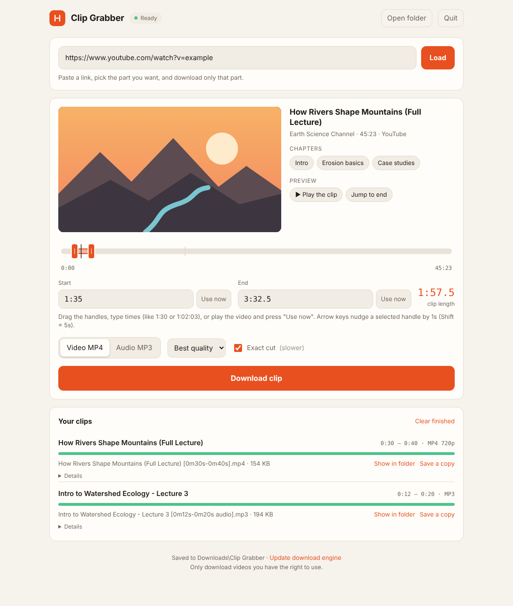

# 🎬 Clip Grabber

**Download just the part of a video you need, not the whole thing.**

Clip Grabber is a small app that runs on your own computer and opens in your browser like a website. Paste a link, drag two handles to pick the part you want, and save only that part as an MP4 video or an MP3 audio file.

<picture>
  <source media="(prefers-color-scheme: dark)" srcset="docs/screenshot-dark.png">
  
</picture>

## ✨ Features

- **Pick your clip visually.** Drag handles on a timeline, type times like `1:30` or `1:02:03`, or pause the preview and click **Use now**.
- **Preview before downloading.** "Play the clip" plays exactly the part you selected.
- **Jump by chapter.** If a video has chapters, click a chapter name to select it.
- **Video or audio.** Save as MP4 at the quality you choose, or as MP3.
- **Exact cuts.** Clips start at the exact second you chose. Turn this off for faster downloads.
- **Private by design.** Everything runs on your computer. Nothing goes through anyone else's server.
- **Handles YouTube's bot check.** Connect your browser's YouTube login in one click when YouTube asks.
- **Sets itself up.** The first start installs everything it needs and keeps the download engine up to date.

## 🚀 Getting started

### 1. Download

Click the green **Code** button at the top of this page, choose **Download ZIP**, and unzip it.

### 2. Install Python (one time)

Get it from [python.org/downloads](https://www.python.org/downloads/).
On Windows, tick **"Add Python to PATH"** on the first setup screen.

### 3. Start it

| Windows | Mac |
|---|---|
| Double-click **`Start Clip Grabber (Windows).bat`** | Double-click **`Start Clip Grabber (Mac).command`**. If macOS blocks it, right-click › Open. |

Your browser opens the app. The first start takes a minute or two while it downloads its tools. Clips are saved to **Downloads › Clip Grabber**.

### Optional: make a Windows `.exe`

Double-click **`Build EXE (Windows).bat`**. After a few minutes you'll find `dist\Clip Grabber.exe`, a single program you can put on your Desktop or share. It doesn't need Python to run.

> Windows may show "Windows protected your PC" because the app isn't signed. Click **More info › Run anyway**.

## 🛠️ How it works

Clip Grabber is a single Python file with no web framework:

- a tiny local web server from Python's standard library, which only accepts connections from your own computer;
- [yt-dlp](https://github.com/yt-dlp/yt-dlp) to find and download just the selected time range;
- [ffmpeg](https://ffmpeg.org) to cut and convert the clip;
- [deno](https://deno.com), a JavaScript runtime that yt-dlp needs for YouTube.

## ❓ Troubleshooting

- **"Sign in to confirm you're not a bot":** YouTube does this on some internet connections, especially mobile data or shared Wi-Fi. Click **YouTube sign-in** at the top of the app and either pick a browser where you're signed in to YouTube (Firefox works best), or export a `cookies.txt` file with the free **Get cookies.txt LOCALLY** extension and choose it there. Your login stays on your computer.
- **Downloads suddenly fail:** click **Update download engine** at the bottom of the app, then restart it. Video sites change often.
- **Want to know what went wrong:** open **Details** under the clip. It shows the full log.
- **Started it twice:** that's fine. A second start just opens the app that's already running.

## ⚖️ Responsible use

Only download videos you have the right to use, such as your own uploads, Creative Commons videos, or clips for personal study. Downloading other people's content may go against a site's terms of service.

## 📄 License

[MIT](LICENSE) © 2026 Ashraful Emon

Built with the help of AI as a learning project. 🌱
